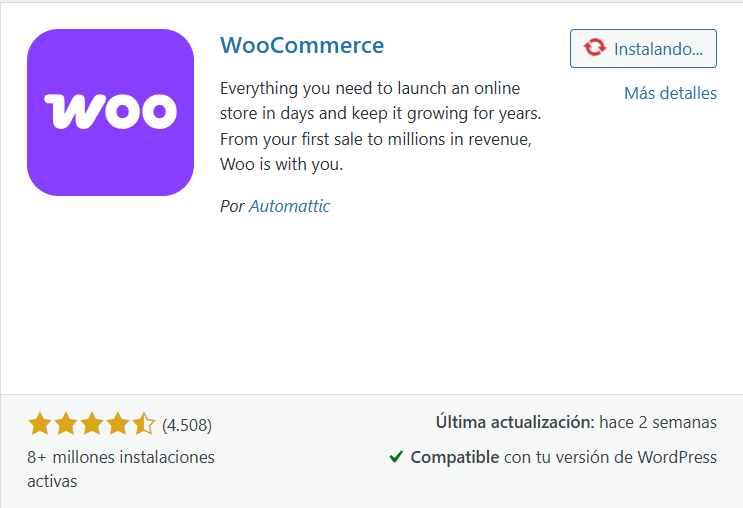

# WordPress with WooCommerce and Apurata Integration

This repository contains a Docker-based setup for WordPress with WooCommerce and Apurata payment gateway integration.

## Setup Instructions

### 1. Running the Application

#### Development Environment
```bash
# Start the development environment
./run_dev.sh
# Access at: http://localhost:8080/
```

#### Production Environment
```bash
# Start the production environment
docker-compose up -d
```

### 2. Install WordPress

Follow the WordPress installation instructions:
1. Select Spanish language
2. Configure timezone for Peru
3. Complete site information

### 3. Install WooCommerce

1. Go to "Plugins" and click "Add New"
2. Search for "WooCommerce" and install the first option

   You can visit the official website: https://woocommerce.com/

    

3. Activate the WooCommerce plugin
4. Follow the setup wizard
5. Verify your store at http://localhost:8080/

### 4. Install aCuotaz Plugin

1. Add your user to the www-data group to edit files:
```bash
sudo adduser myuser www-data
```

2. Restart your console to apply changes

3. Clone the plugin repository:
```bash
cd wordpress/wp-content/plugins
git clone https://github.com/apurata/woocommerce-acuotaz-payment-gateway.git
```

4. Activate the plugin:
   - Go to "Plugins"
   - Search for "WooCommerce aCuotaz Apurata Payment Gateway"
   - Click "Activate"

5. Configure the plugin:
   - Go to plugin "Settings"
   - Check the "Enable HTTP" checkbox
   - Request and configure:
     - Client ID
     - Secret Token

## Features

* HTTPS by default (HTTP must be manually enabled)
* Request validation with secret token
* Apurata payment button visibility rules:
  * Hidden when HTTPS is not used (unless HTTP is manually enabled)
  * Hidden when currency is not PEN
  * Hidden when amount is outside the valid range
* Automatic form population in Apurata funnel with:
  - Name
  - Email
  - Phone

## Important Notes

### Volume Management

The application uses Docker volumes for persistent storage:
- `/var/www/data` is the volume where WordPress files are stored

### Troubleshooting

If you encounter volume-related issues, you can reset them with:
```bash
docker-compose down -v
```

## Environment Configuration

The application uses the following environment variables:
- Database host: `WORDPRESS_DB_HOST`
- Database user: `WORDPRESS_DB_USER`
- Database password: `WORDPRESS_DB_PASSWORD`
- Database name: `WORDPRESS_DB_NAME`

Default values are set in the docker-compose.yml file.

